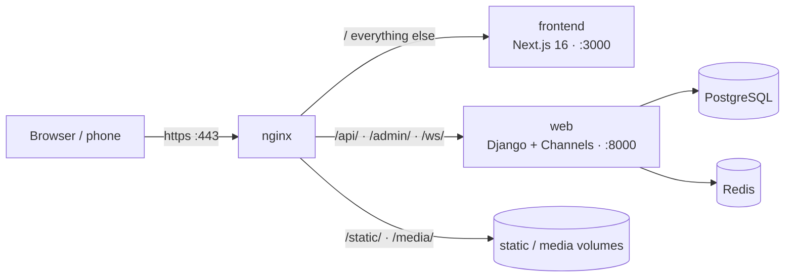
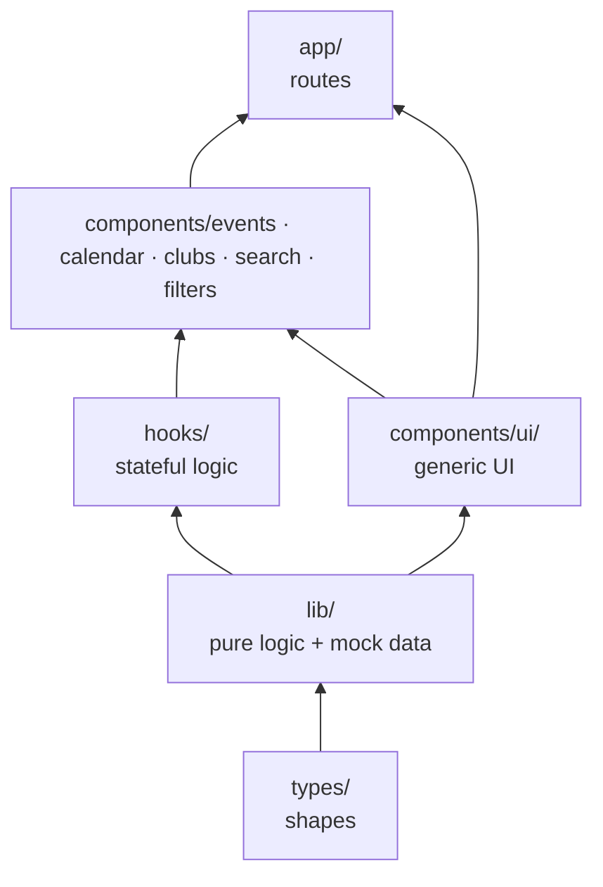
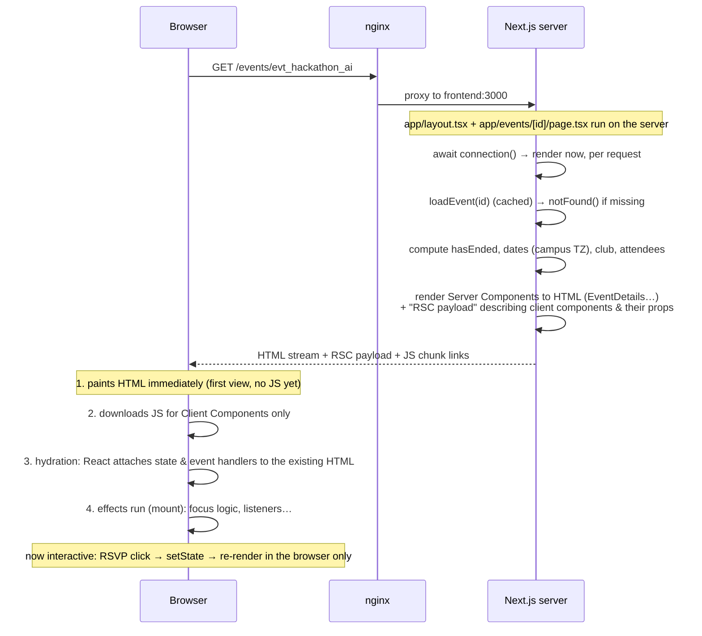
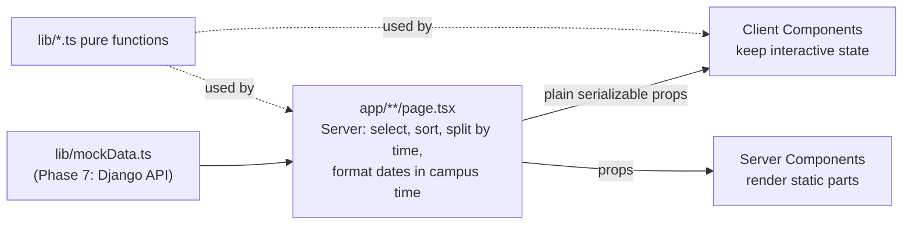

# Campus Hub Frontend — Architecture & Study Guide

**Who this is for:** anyone on the team who needs to find their way around the frontend, change data or pages, or understand *why* the code looks the way it does.

**How it relates to the other docs:**

| File | What it answers |
| --- | --- |
| **`ARCHITECTURE.md`** (this file) | How the whole app fits together, where things live, how data flows, and the React / Next.js concepts behind it. Start here. |
| `DOCS.md` | The detailed engineering record: one entry per component / step, with props, tradeoffs and what was verified (§ numbers are referenced below). |
| `COMPONENT-USAGE.md` | Copy-paste snippets for the basic UI components (Button, Badge, Input, …). |
| `CLAUDE.md` / `AGENTS.md` | Rules for the AI assistant (also a good summary of the coding rules). |

*Last updated: 2026-11-06 (end of Phase 4 + campus background + dev setup).*

---

## Table of contents

1. [The big picture](#1-the-big-picture)
2. [Running it](#2-running-it)
3. [Directory map: every folder and its job](#3-directory-map-every-folder-and-its-job)
4. [The dependency rule (who may import whom)](#4-the-dependency-rule-who-may-import-whom)
5. [Routes and the app shell](#5-routes-and-the-app-shell)
6. [Life of a request (server → browser)](#6-life-of-a-request-server--browser)
7. [Data: where it comes from and how it flows](#7-data-where-it-comes-from-and-how-it-flows)
8. [State: who owns what](#8-state-who-owns-what)
9. [Styling](#9-styling)
10. [Accessibility patterns used everywhere](#10-accessibility-patterns-used-everywhere)
11. [Study guide: React & Next.js concepts used in this codebase](#11-study-guide-react--nextjs-concepts-used-in-this-codebase)
12. [Recipes: how do I…?](#12-recipes-how-do-i)
13. [Coding rules](#13-coding-rules)
14. [Known gaps and what comes next](#14-known-gaps-and-what-comes-next)
15. [Glossary](#15-glossary)

---

## 1. The big picture

Campus Hub is the **student & public web app** for 1337 Coding School and EMINES (UM6P): discover events, browse the calendar, browse clubs, RSVP. The organizer dashboard and superadmin portal are a **separate app** (`dashboard_campus`, branch `Ayoub`).



- Everything runs in **Docker Compose** (`docker-compose.yml` at the repo root): `nginx`, `frontend`, `web`, `db`, `redis`.
- `nginx` terminates HTTPS (port 80 redirects to 443) and routes by path (`infrastructure/nginx/nginx.conf`).
- **Today the frontend uses mock data** (`src/lib/mockData.ts`). It doesn't call Django yet; that's Phase 7. Login is mocked too (Phase 5).

**Stack:** Next.js 16 (App Router, Turbopack) · React 19 · TypeScript (strict) · Tailwind CSS v4. No other runtime dependencies (no state library, no date library, no UI kit).

---

## 2. Running it

Commands from the **repo root**:

| Command | What it does |
| --- | --- |
| `make dev` | Everything, with the frontend **source mounted** into its container: save a file → the page reloads in ~2 s. Use this while developing. |
| `make up` | Everything, using the code baked into the image (no live reload). The team default. |
| `make typecheck` | TypeScript check (`tsc --noEmit`) inside the container. |
| `make lint` | ESLint inside the container. |
| `make clear-images` | Forget Next's resized copies of images. Run it after replacing a file in `public/` **with the same name** (see §7.5). |
| `make logs` / `make down` | Follow logs / stop. |

- Open **`https://localhost`** (accept the self-signed certificate). From a phone on the same Wi-Fi: `https://<your-mac-ip>`.
- **`node_modules` only exists inside the container.** Run npm there: `docker compose exec frontend npm install <pkg>`, then `make dev` to rebuild.
- `/test` is the **dev-only test page** where every new piece is tried before it goes into a real page (it's a 404 in production). See §12.

---

## 3. Directory map: every folder and its job

```
frontend/
├── ARCHITECTURE.md · DOCS.md · COMPONENT-USAGE.md · CLAUDE.md · AGENTS.md   docs
├── next.config.ts        output: 'standalone' (small Docker image), allowedDevOrigins (phones on the LAN)
├── eslint.config.mjs     Next 16 flat config (core-web-vitals + typescript)
├── tsconfig.json         strict; path alias  @/*  →  src/*
├── postcss.config.mjs    Tailwind v4 plugin
├── Dockerfile · .dockerignore
├── public/               static files served as-is (/mock/events/*.png flyers)
└── src/
    ├── app/              ROUTES (Next.js App Router): one folder = one URL segment
    ├── components/       RENDERING: React components, grouped by feature
    │   ├── ui/           generic building blocks (Button, Card, Modal, Tabs, Toast…)
    │   │   └── layout/   the app shell (AppShell, Navbar, MobileNav, Footer, CampusBackground…)
    │   ├── providers/    app-wide React Context (SessionProvider)
    │   ├── events/       event feed, event cards, event page parts
    │   ├── calendar/     month/week grids, day agenda, header
    │   ├── clubs/        club cards, directory, club page parts
    │   ├── search/       ⌘K search palette
    │   └── filters/      filter controls shared by several pages (CampusToggle)
    ├── hooks/            reusable React hooks (logic with state/effects, no markup)
    ├── lib/              PURE LOGIC & DATA: functions, constants, mock data (no React rendering)
    └── types/            SHAPES: TypeScript types shared by everything (API contracts)
```

**The one-line rule:** `types/` holds shapes, `lib/` holds data and pure functions, `hooks/` holds stateful logic, `components/` holds rendering, `app/` wires routes to components.

### 3.1 `src/app/` — routes

Every folder is a URL segment; special file names have special meaning (§11.2).

| Path | URL | Role |
| --- | --- | --- |
| `layout.tsx` | (all) | **Root layout**: `<html>`, `<body>`, fonts, the campus background, `ToastProvider` → `SessionProvider` → `AppShell`. Wraps every page. Holds the mock session (`INITIAL_SESSION`) and `BACKGROUND_INTENSITY`. |
| `globals.css` | (all) | Imports Tailwind; defines the drawer / fade-in animations. |
| `page.tsx` | `/` | Discover feed. Server: upcoming events + formatted times → `<EventFeed>`. |
| `calendar/page.tsx` | `/calendar` | Server: today + events per day + times → `<EventCalendar>`. |
| `clubs/page.tsx` | `/clubs` | Server: sorted clubs + upcoming counts → `<ClubDirectory>`. |
| `clubs/[slug]/page.tsx` | `/clubs/leet-dev` | Club page: header + contact (server decides) + events. |
| `clubs/[slug]/not-found.tsx` | | "Club not found" 404. |
| `events/[id]/page.tsx` | `/events/evt_…` | Event page: details (server) + RSVP/attendees (client). |
| `events/[id]/not-found.tsx` | | "Event not found" 404. |
| `not-found.tsx` | any unknown URL | Global 404. |
| `test/page.tsx` | `/test` | Dev-only test bench (404 in production). `SessionSwitcher.tsx` = test tool. |

### 3.2 `src/components/ui/` — generic building blocks

Know nothing about events or clubs. Reused everywhere.

| File | What it is |
| --- | --- |
| `Button.tsx` | Variants (primary/secondary/danger/ghost), sizes, loading spinner, icons. |
| `Badge.tsx` | Status / category pills. |
| `Input.tsx`, `Select.tsx` | Form fields with label ↔ input binding (`useId`). |
| `Card.tsx` | Compound card: `Card`, `CardBanner` (next/image + fallback), `CardHeader`, `CardTitle`, `CardContent`, `CardFooter`. |
| `Avatar.tsx` | Image or initials; `AvatarGroup` with "+N". |
| `Modal.tsx` | Dialog in a portal: scroll lock, Escape, focus trap, focus return, `ModalTitle` names it, `position` center/top. |
| `Tabs.tsx` | Compound tabs with roving focus and arrow keys; controlled or uncontrolled. |
| `Toast.tsx` | `ToastProvider` + `useToast().showToast(...)`; live region. |
| `Skeleton.tsx` | Loading placeholders. |
| `EmptyState.tsx`, `FilterChip.tsx` | "Nothing here" box; toggle chip. |

### 3.3 `src/components/ui/layout/` — the app shell

| File | What it is |
| --- | --- |
| `AppShell.tsx` | **The one client component that assembles the shell**: navbar, `<main>`, footer slot, phone tab bar, phone drawer, search palette. Owns shared shell state (search open, notifications). |
| `Navbar.tsx` | Compound navbar: brand, links (active route), search button (⌘K), session area. |
| `MobileNav.tsx` | Phone bottom tab bar + slide-out drawer (+ spacer so content isn't hidden). |
| `NotificationPopover.tsx` | Bell + popover (mock notifications until Phase 6). |
| `Footer.tsx` | Server-rendered footer, passed into AppShell as a slot. |
| `navIcons.tsx` | `IconBase` + icon set (all `aria-hidden`). |
| `CampusBackground.tsx` + `.module.css` | The fixed campus line-art backdrop (Server Component, CSS Module). |

### 3.4 Feature folders

| Folder | Files | Used by |
| --- | --- | --- |
| `events/` | `EventFeed` (feed state: filters + RSVP), `FeedToolbar`, `CategoryFilter`, `EventGrid`, `EventCard`, `EventDetails` (server), `EventPageShell` (event page state), `RsvpCard`, `AttendeesSection`, `eventStyles.ts` | `/`, `/events/[id]`, club pages |
| `calendar/` | `EventCalendar` (state: selected day + view), `CalendarHeader`, `MonthGrid`, `WeekGrid`, `DayAgenda`, `dayStyles.ts` | `/calendar` |
| `clubs/` | `ClubDirectory` (state: campus filter), `ClubCard`, `ClubHeader` (server), `ClubContactCard`, `ClubEvents` (state: RSVP) | `/clubs`, `/clubs/[slug]` |
| `search/` | `SearchPalette` | AppShell (navbar + ⌘K) |
| `filters/` | `CampusToggle` (All / 1337 / EMINES) | feed, clubs directory |
| `providers/` | `SessionProvider` + `useSession()` | root layout; read by navbar, RSVP, attendees, contact card… |

### 3.5 `src/hooks/`

| Hook | Does |
| --- | --- |
| `useDebouncedValue(value, ms)` | Returns the value once it stopped changing (search input). |
| `useDayGridNavigation(selected, onSelect)` | Arrow-key navigation + focus management for the month and week grids. |
| `useRsvpToast()` | The "You're going" / "RSVP cancelled" toast, same everywhere. |
| `useCampusSearch(query)` | **The search data boundary**: mocks today, API in Phase 7. |

### 3.6 `src/lib/` — pure logic and data

No JSX, no state. Easy to test, safe on server and client (except where marked *server only*).

| File | Contents |
| --- | --- |
| `mockData.ts` | **All fake data**: `mockCurrentUser`, `mockDepartments`, `mockClubs`, `mockEvents`, `mockNotifications`, `getMockAttendees`. Phase 7 replaces it with API calls. |
| `events.ts` | Campus/category constants and labels, `normalizeText`, `matchesCampus`, `filterEvents`, `getUpcomingEvents`, `toggleRsvp`, `getEventById`, `getClubById`. |
| `clubs.ts` | `getClubBySlug`, `getUpcomingEventCounts`, `getClubEvents`, `sortClubsByName`, `filterClubsByCampus`, `getClubContact`, `formatClubSince` *(server)*, `formatPhone`. |
| `calendar.ts` | `DayKey` date maths (client-safe), month/week matrices, view steps/titles; *server only*: `toCampusDayKey`, `getEventIdsByDay`, `getEventTimes`, `getEventDateDetails`. |
| `time.ts` | `CAMPUS_TIME_ZONE = 'Africa/Casablanca'`, relative time, `getEventSchedules` *(server)*. |
| `search.ts` | `searchCampus` ranking, `getSearchSuggestions`. |
| `navigation.ts` | Nav links, footer link groups, `isNavItemActive`. |
| `focus.ts` | `FOCUSABLE_SELECTOR`, `trapTabKey` (keep Tab inside overlays). |
| `refs.ts` | `useMergedRef` (forward a ref *and* keep your own). |

### 3.7 `src/types/` — shared shapes

| File | Contents |
| --- | --- |
| `api.ts` | The API contract: `User`, `Department`, `Club`, `EventItem`, `EventCategory`, `AttendeePreview`, `ApiResponse<T>`, WebSocket payloads. **Change data shapes here first.** |
| `session.ts` | `SessionState` = `loading` \| `signed-out` \| `signed-in` + user. |
| `navigation.ts` | `AppRoute`, `NavItem`, footer link types. |
| `notification.ts` | `AppNotification`. |

---

## 4. The dependency rule (who may import whom)



Arrows point from "is imported by" to "imports": read it as **lower layers never import higher layers**.

- `types/` imports nothing from the app.
- `lib/` imports only `types/` and other `lib/` files. **Never React components.**
- `components/ui/` never imports a feature folder (a Button doesn't know what an event is).
- Feature folders may import `ui/`, `hooks/`, `lib/`, `types/`, and (rarely) each other (`clubs/ClubEvents` reuses `events/EventGrid`).
- `app/` pages import whatever they need, but stay thin: fetch/compute data, render components.
- Always import with the alias: `@/lib/events`, not `../../lib/events`.

---

## 5. Routes and the app shell

### 5.1 What wraps every page

```
<html>                                        app/layout.tsx  (Server)
 └─ <body>  bg-slate-50 / dark:bg-slate-950
     ├─ <CampusBackground/>                   fixed, z-index -1, decorative   (Server)
     └─ <ToastProvider>                       toasts for the whole app        (Client)
         └─ <SessionProvider initialSession>  who is signed in                (Client)
             └─ <AppShell footer={<Footer/>}> the shell                       (Client)
                 ├─ <MobileNav>               context for the phone drawer
                 │   ├─ <Navbar>  brand · links · search button · bell · session
                 │   ├─ <main id="main-content">  ← THE PAGE GOES HERE
                 │   ├─ footer (rendered on the server, passed in as a prop)
                 │   ├─ <MobileTabBarSpacer/> · <MobileTabBar/>
                 │   ├─ <SearchPalette/>      ⌘K, portal to <body> when open
                 │   └─ <MobileNavDrawer/>
```

The **layout never re-renders when you navigate** between pages: only the `{children}` inside `<main>` changes. That's why shell state (e.g. the session, an open search) survives navigation (and why the `/test` session switcher once leaked into other pages, DOCS §6.13).

### 5.2 Route map

| URL | Server part (page) | Client part (state) | Docs |
| --- | --- | --- | --- |
| `/` | upcoming events, `getEventSchedules` | `EventFeed`: campus/category filters, RSVPs | §5 |
| `/calendar` | `todayKey`, `getEventIdsByDay`, `getEventTimes` | `EventCalendar`: selected day, Month/Week | §6.1–6.6 |
| `/events/[id]` | lookup, `notFound`, metadata, `EventDetails`, dates, attendees | `EventPageShell`: RSVP state shared by `RsvpCard` + `AttendeesSection` | §6.7–6.10 |
| `/clubs` | sort, upcoming counts | `ClubDirectory`: campus filter | §6.11–6.12 |
| `/clubs/[slug]` | lookup, `notFound`, metadata, `ClubHeader`, contact decision, events split | `ClubContactCard` (session), `ClubEvents` (RSVP) | §6.13–6.15 |
| ⌘K | — | `SearchPalette` in `AppShell` | §6.16–6.17 |

---

## 6. Life of a request (server → browser)

Example: a student opens **`/events/evt_hackathon_ai`**.



Key points:

1. **The page file is a Server Component.** It runs only on the server, can read data directly, and ships **no JavaScript** for itself.
2. **Interactive parts are Client Components** (`'use client'`), e.g. `EventPageShell`. They are rendered to HTML on the server too (that's SSR), then **hydrated** in the browser.
3. `EventDetails` is a Server Component passed *as `children`* into the client `EventPageShell`: it stays server-only (no JS), even though it's displayed inside a client component (§11.1).
4. **`await connection()`** makes the page render **per request** (dynamic). Without it Next.js would prerender the page at build time and "now" would be frozen at the build date (DOCS §5.5).
5. **Client-side navigation:** clicking a `<Link>` to another page does *not* reload the document. The browser fetches only the new page's RSC payload, React swaps `<main>`'s content, and the layout + its state stay.

---

## 7. Data: where it comes from and how it flows

### 7.1 The pipeline



- **Mock data is the single source** today: `src/lib/mockData.ts`. Change an event's title there and it changes everywhere.
- **Pages (server) prepare the data**, then pass **plain data** (strings, numbers, arrays, objects) to components. Props crossing from server to client must be serializable: no functions, no `Date` objects, no class instances.
- **Lookups and rules live in `lib/`** (e.g. `getUpcomingEvents`, `getClubEvents`, `searchCampus`) so pages, components and Phase 7 API code share the same logic.

### 7.2 The time-zone rule (important)

Event times must show in **campus time** (`Africa/Casablanca`) whatever the visitor's device says. Morocco's offset changes by decree, and **browsers ship different time-zone data than the server** (in Nov 2026 the server says UTC+0, some browsers UTC+1). If the server formats "5:00 PM" and the browser formats "6:00 PM" from the same timestamp, React reports a **hydration mismatch** (§11.4).

**So:** anything that turns a *moment* (`'2026-11-05T17:00:00Z'`) into a *date or time text* runs **on the server only** and is passed down as a string:
`getEventSchedules`, `getEventTimes`, `getEventDateDetails`, `toCampusDayKey`, `getEventIdsByDay`, `formatClubSince`.
Pure *date* maths on `'YYYY-MM-DD'` strings (`DayKey`, `addDays`, `buildMonthMatrix`) is time-zone-free and safe in the browser (DOCS §5.2, §6.2).

### 7.3 Where to change what

| I want to… | Edit |
| --- | --- |
| Change/add an event, club, user, notification | `src/lib/mockData.ts` |
| Add a field to events/clubs | `src/types/api.ts` first, then mock data, then the components that show it (TypeScript will list every place that breaks) |
| Change how events are filtered/sorted/searched | `src/lib/events.ts`, `src/lib/search.ts`, `src/lib/clubs.ts` |
| Change date/time wording | `src/lib/calendar.ts`, `src/lib/time.ts` (server-only functions!) |
| Change category names/colours | `CATEGORY_LABELS` in `lib/events.ts`; colours in `Badge.tsx`, `eventStyles.ts`, `calendar/dayStyles.ts`, `DayAgenda.tsx` |
| Change nav/footer links | `src/lib/navigation.ts` (+ `AppRoute` in `types/navigation.ts`) |
| Change who is "signed in" (mock) | `INITIAL_SESSION` in `src/app/layout.tsx` (or the `/test` session switcher) |
| Change background strength | `BACKGROUND_INTENSITY` in `src/app/layout.tsx` |

### 7.4 Phase 7: from mocks to the API

The design keeps the swap small: replace `mockEvents`/`mockClubs` reads in the **pages** (and `useCampusSearch`, `getMockAttendees`) with `fetch` calls to Django; components don't change because their props stay the same shapes (`types/api.ts`). Wrap fetches in React `cache()` when both `generateMetadata` and the page need them (already done with `loadEvent` / `loadClub`).

### 7.5 Images and caching (read before replacing or uploading images)

**How `next/image` works here.** `CardBanner` (and every flyer) uses `next/image`. The browser never downloads the original file: it asks for `/_next/image?url=/mock/events/x.png&w=1080&q=75`, Next resizes the original to that width, converts it (WebP), **saves the result** and serves it. The saved copy is keyed by **URL + width + quality, not by the file's content**, and it is kept for at least `minimumCacheTTL` (4 hours by default in Next 16) or longer if the image server says so.

| What | Cached? | When it changes |
| --- | --- | --- |
| Page data (events, RSVPs, clubs) | **No.** Pages call `await connection()` (rendered per request), and `fetch` isn't cached by default in Next 16 | Visible on the next reload |
| Images (flyers, logos) | **Yes, per URL** (container: `.next/dev/cache/images`; production: `.next/cache/images`) | A **new URL** is fresh immediately; **same URL, new content** stays stale until the copy expires |

**Rules that follow from this:**

1. **Replacing a mock image in `public/`:** either give it a **new file name** (and update `mockData.ts`), or keep the name and run `make clear-images`, then hard-refresh (⌘⇧R). Clearing only the browser cache is not enough: the large widths (1080, 1920) a Retina screen asks for come from the server's saved copies.
2. **Keep source images reasonable:** ≤ ~2000 px wide, ≤ ~3 MB. A 77 MB, 8256 px photo made the optimizer time out (504 after 60 s) and the card showed nothing (2026-11-06). Resize on macOS with `sips -Z 1600 file.png`.
3. **Phase 7, uploaded images (requests for the backend):**
   - **Unique file names per upload** (UUID via Django `upload_to`). Replacing a flyer must produce a **new URL**, never overwrite the old file, so no cache ever goes stale. Fallback if names must stay fixed: a version in the URL (`?v=<updated_at>`).
   - **Reject oversized uploads** (e.g. > 10 MB or > 4000 px) at the API.
   - **Where Next fetches them from:** uploads live under Django's `/media/`, which the frontend server doesn't serve itself. Preferred: absolute URLs + `images.remotePatterns` for the backend host in `next.config.ts`, so Next keeps resizing them. Alternative: nginx serves `/media/` directly with long cache headers and those images use `unoptimized` (no automatic resizing).

---

## 8. State: who owns what

**Rule of thumb: state lives in the lowest component that all its users share** ("lifting state up"), and nowhere else.

| State | Owner | Shared with | How |
| --- | --- | --- | --- |
| Signed-in user | `SessionProvider` (root) | navbar, tab bar, RSVP card, attendees, contact card | Context + `useSession()` |
| Toasts | `ToastProvider` (root) | anyone | Context + `useToast()` |
| Search open, notifications | `AppShell` | navbar button, palette, bell | props |
| Feed filters + RSVPs | `EventFeed` | toolbar, chips, grid, cards | props + callbacks |
| Calendar selected day + view | `EventCalendar` | header, grids, agenda | props + callbacks |
| Event page RSVP | `EventPageShell` | `RsvpCard`, `AttendeesSection` | props + callbacks |
| Club directory campus | `ClubDirectory` | toggle, grid | props |
| Tabs selection | `Tabs` (or its parent if controlled) | `TabsTrigger`, `TabsContent` | internal Context |
| Phone drawer open | `MobileNav` | trigger, drawer | internal Context |

**Example, RSVP on the event page:**

```
EventPageShell  [event, setEvent]
 ├─ AttendeesSection  event={event}                 → shows "You" if event.has_user_rsvpd
 └─ RsvpCard          event={event}  onRsvpToggle   → click calls onRsvpToggle(event)
        ↓
 handleRsvpToggle(before) { setEvent(toggleRsvp); announceRsvp(before) }
        ↓ React re-renders EventPageShell → both children get the new event
```

Data goes **down** as props; changes go **up** as callbacks. Each page holds its own copy for now, so an RSVP on the event page shows on `/` only after a reload (the API will be the shared source of truth in Phase 7).

---

## 9. Styling

### 9.1 Tailwind CSS v4

- Classes in JSX (`className="rounded-xl bg-white p-4"`), compiled at build time; only used classes are shipped. Setup: `@import "tailwindcss"` in `globals.css` + the PostCSS plugin. Custom animations are declared in `globals.css` under `@theme`.
- **Variants:** `hover:`, `focus-visible:`, `sm: md: lg: xl:` (mobile-first breakpoints 640/768/1024/1280px), `dark:`, `motion-reduce:`, `rtl:`, `aria-pressed:`, `aria-[current=page]:`, `after:` (pseudo-element), `group-hover:`.
- **Tailwind must see full class names in the source.** Never build them from pieces (`` `bg-${color}-500` `` won't work). That's why colours per variant are written out in lookup tables (below).

### 9.2 Lookup tables instead of conditionals (house rule)

```ts
const chipStyles: Record<EventCategory, string> = {
  Tech: 'bg-lime-500/15 text-lime-700 dark:text-lime-400',
  Media: 'bg-violet-500/15 text-violet-700 dark:text-violet-400',
  // … every category, or TypeScript errors
};
<span className={chipStyles[event.category]} />
```

`Record<Key, Value>` is **exhaustive**: add a new category to the type and the build fails until every table has it. Used for variants, sizes, states (`RsvpState`, `DayTone`, `ContactState`) and even keyboard moves (`GRID_MOVES`, `TAB_MOVES`).

### 9.3 Design tokens

| Token | Light | Dark |
| --- | --- | --- |
| Brand | `violet-600`, hover `violet-700` | accent `violet-400` |
| Page surface | `bg-slate-50` | `bg-slate-950` |
| Card surface | `bg-white` | `bg-slate-900` |
| Border | `border-slate-200/80` | `border-slate-800` |
| Status | emerald (success) · amber (warning) · rose (danger) · slate (neutral) | |
| Categories | Tech lime · Media violet · Music indigo · Sports teal · Business orange · Gaming fuchsia · Events sky | |

### 9.4 Dark mode

Follows the **operating system** (`prefers-color-scheme`): Tailwind's default `dark:` variant is a media query. There's no theme toggle and no `.dark` class. Every component writes both: `bg-white dark:bg-slate-900`.

### 9.5 CSS Modules (one place)

`CampusBackground.module.css`: real CSS (masks, gradients, CSS variables, media queries) is clearer than utilities for the background. `import styles from './X.module.css'` → `className={styles.root}`; class names are hashed so they never clash.

### 9.6 Layout techniques worth knowing

- **Responsive grid:** `grid grid-cols-1 sm:grid-cols-2 lg:grid-cols-3`. Keep `grid-cols-1`: it caps the phone column at the screen width (without it a long word widens the whole page, DOCS §5.7).
- **Stretched link:** the card title's `<Link>` gets `after:absolute after:inset-0`, so its invisible `::after` covers the whole card: one link, one tab stop, whole card clickable (EventCard, ClubCard, DayAgenda).
- **`sticky`** (RSVP card, agenda beside the grid) and **`fixed`** (phone RSVP bar, tab bar, background).
- **Logical properties for Arabic (RTL):** `text-start`, `border-s-4`, `rtl:-scale-x-100` on arrows: they flip automatically when the page is `dir="rtl"`.
- **Safe areas:** `env(safe-area-inset-bottom)` keeps bars above the iPhone home indicator.

---

## 10. Accessibility patterns used everywhere

| Pattern | Where | Idea |
| --- | --- | --- |
| Landmarks & one `h1` per page | all pages | `<main>`, `<nav>`, `<search>`, `<aside>`, `<section aria-labelledby>`; headings never skip a level (`headingLevel` props). |
| Label binding with `useId()` | Input, Select, sections | `id`/`htmlFor`/`aria-labelledby` that are unique and SSR-safe. |
| Decorative = hidden | icons, avatars, background | `aria-hidden="true"`; icon-only buttons get `aria-label`. |
| Live regions | result counts, toasts, calendar title | `aria-live="polite"`: screen readers hear changes without moving focus. |
| Roving `tabIndex` | Tabs, month/week grids | Only one item in a group is Tab-reachable; arrow keys move inside the group. |
| Combobox + `aria-activedescendant` | search palette | Focus stays in the input; arrows move a "virtual" highlight. |
| Focus management | Modal, drawer, popover, grids | Move focus in on open, trap Tab, return focus on close; move focus to the new day after a month change. |
| Toggle buttons | campus toggle, filters | `aria-pressed` for on/off buttons. |
| Reduced motion | cards, transitions | `motion-reduce:` disables movement. |

---

## 11. Study guide: React & Next.js concepts used in this codebase

Each concept: **what it is**, **where we use it**, **the trap to avoid**.

### 11.1 Server Components vs Client Components

- **Server Component (default):** runs only on the server; can be `async`, read data, use secrets; **ships no JS**; **cannot** use state, effects, event handlers or browser APIs. *Ours:* every `page.tsx`, `layout.tsx`, `EventDetails`, `ClubHeader`, `ClubCard`, `Footer`, `CampusBackground`.
- **Client Component:** file starts with `'use client'`; can use `useState`, `useEffect`, `onClick`, `window`. It is **still rendered to HTML on the server** first (SSR), then hydrated. *Ours:* `AppShell`, `EventFeed`, `EventCalendar`, `RsvpCard`, `Modal`, `Tabs`, `SearchPalette`…
- **The boundary:** `'use client'` marks a file as an entry into client code; everything it imports becomes client code too.
- **Passing server components into client ones:** pass them as `children`/props from a server file (`<EventPageShell><EventDetails/></EventPageShell>` in `events/[id]/page.tsx`). Imported *inside* a client file, they'd become client code.
- **Props from server to client must be serializable.** No functions (that's why the page can't pass `onClick` to a client component; the client component defines its own handlers).
- **Trap:** a component using a hook without `'use client'` works only as long as every caller is client code (that was `Avatar`'s bug, DOCS §2.3).

### 11.2 App Router file conventions

| File | Meaning |
| --- | --- |
| `page.tsx` | Makes the folder a URL. |
| `layout.tsx` | Wraps pages below it; **persists across navigation**. |
| `not-found.tsx` | Shown by `notFound()` or for unknown URLs, inside the layout; HTTP 404. |
| `[id]` / `[slug]` folders | **Dynamic segments**: `params.id`. In Next.js 16 **`params` and `searchParams` are Promises**: `const { id } = await params`. |
| `_folder` | Private, never a route. |
| `metadata` / `generateMetadata` | `<title>`, description, Open Graph per page. |

### 11.3 Rendering modes: SSR, CSR, static, dynamic, streaming

- **SSR (server-side rendering):** HTML is generated on the server per request; the user sees content before JS loads. *All our pages.*
- **CSR (client-side rendering):** the browser renders/updates with JS. *Everything after hydration:* filtering the feed, switching calendar month, opening the palette.
- **Static (prerendered at build):** HTML made once at `next build`. Only `/test` and the global 404 are static here.
- **Dynamic:** rendered per request. **`await connection()`** opts a page in (it reads "now"). The build output shows `ƒ` for dynamic, `○` for static.
- **Streaming:** the server sends HTML in chunks as parts finish. A `notFound()` in a dynamic page in dev arrives in the streamed payload (the status code is already 404).

### 11.4 Hydration (and mismatches)

**Hydration** = React in the browser walks the server HTML and attaches state and event handlers, *expecting the browser's first render to produce exactly the same HTML*.

Mismatches happen when the first client render differs from the server's: `Date.now()`, `Math.random()`, `window.innerWidth`, the browser's time zone, the user's OS (Mac vs Windows) read **during render**.

How we avoid them:
- **Server decides time-dependent things** (`hasEnded`, `todayKey`, formatted dates) and passes strings down (§7.2).
- **Mount guard** for browser-only values: render a neutral version first, then switch after mount. *Example:* `NavbarSearch` shows "Ctrl" on the server and first render, then "⌘" after an effect detects a Mac (hidden until mounted, so no flash).
- `suppressHydrationWarning` only on `<html>` (browser extensions add attributes there).

### 11.5 Component lifecycle: mounting, updating, unmounting

```
mount    → component appears: first render → DOM inserted → effects run (useEffect)
update   → state/props change: re-render → DOM patched → effects whose deps changed re-run (cleanup first)
unmount  → component removed: effect cleanups run → DOM removed → its state is gone
```

- **`useEffect(fn, deps)`** runs *after* the browser paints; return a **cleanup** function to undo it. *Ours:* window `keydown` for ⌘K (cleanup removes the listener), Modal scroll lock (cleanup restores `overflow`), Escape listener, popover clock interval, `SessionSwitcher` restoring the session on unmount.
- **Dependencies:** `[]` = only on mount/unmount; `[a, b]` = when `a` or `b` change; none = after every render.
- **Strict Mode (dev only)** mounts, unmounts and re-mounts every component once to surface missing cleanups. Effects must be safe to run twice. *Trap:* a toast fired inside a state updater appears twice; that's why `announceRsvp` is called outside `setEvent(...)`.
- **Mount guard** (`const [mounted, setMounted] = useState(false); useEffect(() => setMounted(true), [])`): lets `Modal`/drawer use `document`/`createPortal` only after hydration. Newer React lint rules prefer `useSyncExternalStore`; cleanup planned (DOCS §1.5b).
- **Remounting on purpose with `key`:** changing a component's `key` throws its state away and mounts a fresh one. *Ours:* the `/test` scenarios always render the demo with `key={scenario}` so switching scenario starts from fresh state. In lists, `key` is how React matches items between renders (always a stable id, never the array index when items can reorder).
- **What unmounts on navigation:** the page under `<main>`; the layout and shell stay mounted.

### 11.6 State & hooks

| Hook | What for | Example |
| --- | --- | --- |
| `useState` | Values that change and re-render | filters, selected day, `isOpen` |
| Functional update `setX(prev => …)` | When the new value depends on the old one | `setEvent(toggleRsvp)`, `setSelectedKey(k => CALENDAR_STEPS[view](k, 1))` |
| `useMemo` | Cache an expensive derived value | `eventsByDay` from ids in `EventCalendar` |
| `useCallback` | Stable function identity (so children/effects don't re-run) | `openSearch` passed to `NavbarSearch` |
| `useRef` | A mutable box that survives renders without re-rendering; DOM handles | `focusPending` in grids, `surfaceRef` in Modal |
| `useId` | Unique ids identical on server and client | labels, `aria-controls`, palette options |
| `useContext` | Read a provider's value | `useSession`, `useToast`, Tabs internals |
| Custom hooks | Reusable stateful logic | `useDayGridNavigation`, `useRsvpToast`, `useCampusSearch` |

- **Derived state:** don't store what you can compute. The calendar stores only `selectedKey`; the month shown is *derived* from it. The search palette's options are derived from `query`.
- **Controlled vs uncontrolled:** `Tabs` accepts `value` + `onValueChange` (parent owns state) **or** `defaultValue` (Tabs owns it).

### 11.7 Composition patterns

- **Compound components + Context:** `<Tabs><TabsList><TabsTrigger/></TabsList><TabsContent/></Tabs>`, `<Card><CardBanner/>…`, `<Navbar><NavbarBrand/>…`, `<Modal><ModalHeader><ModalTitle/>…`. Parts share state through a private Context; callers arrange the parts.
- **Slots via props:** `AppShell footer={…}`, `EmptyState action={…}`, `CardBanner fallback={…}`.
- **`forwardRef`:** lets a parent get the underlying DOM node (focus it, measure it). Combine with your own ref via `useMergedRef`.
- **Portals (`createPortal`):** render a subtree into `document.body` (Modal, drawer) so it escapes parent `overflow`/`z-index`, while staying in the React tree (context and events still work).

### 11.8 Next.js data & routing helpers

| API | What | Where |
| --- | --- | --- |
| `connection()` | Make the page dynamic (per request) | all main pages |
| `notFound()` | Render the nearest `not-found.tsx` with 404 | event & club pages |
| `generateMetadata` | Per-page title/description/OG | event & club pages |
| `cache()` (React) | Dedupe a lookup within one request | `loadEvent`, `loadClub` |
| `<Link>` | Client-side navigation + prefetch | everywhere |
| `useRouter().push` | Navigate from code | search palette |
| `usePathname()` | Current URL → active nav link | Navbar, tab bar |
| `next/image` | Responsive, lazy images (`sizes`, `loading="eager"` for the first visible ones) | `CardBanner` |

### 11.9 Keyboard and focus (React side)

- **Roving tabindex:** only the selected item has `tabIndex={0}`, the others `-1`; an `onKeyDown` on the group moves focus and selection (`Tabs`, `MonthGrid`, `WeekGrid`).
- **Focus after re-render:** set a ref flag before the state change, then focus the new element in an effect (`useDayGridNavigation`).
- **Focus trap:** `trapTabKey` on Tab inside overlays; restore focus to the trigger on close.

### 11.10 Optimistic UI

RSVP updates the UI immediately (`setEvent(toggleRsvp)`) and shows a toast; in Phase 7 the request is sent after, and on failure the state is rolled back with an error toast.

---

## 12. Recipes: how do I…?

### Try something new safely (the `/test` workflow)
1. Build the component; render it in `src/app/test/page.tsx` (add scenarios via `?scenario=`; use `SessionSwitcher` to test signed in/out).
2. Check it in the browser (mouse, keyboard, phone width, dark mode) using the checklist on the page.
3. Move it into the real page; reset `/test`.
4. Add/update the entry in `DOCS.md`.

### Add a new page (e.g. `/about`)
1. Create `src/app/about/page.tsx` exporting a default (async) Server Component and `metadata`.
2. Need "now" or per-request data? `await connection()` first.
3. Need interactivity? Put it in a `'use client'` component under `src/components/<feature>/` and render it from the page.
4. Add the link in `src/lib/navigation.ts` (+ `AppRoute` in `types/navigation.ts`).

### Add a field to events (e.g. `capacity`)
1. `types/api.ts` → add `capacity: number` to `EventItem`.
2. `make typecheck` → TypeScript lists every mock/object missing it; fill `mockData.ts`.
3. Show it: e.g. in `EventDetails` (server) or `RsvpCard` (client).

### Add an event category
1. Add it to `EventCategory` in `types/api.ts` and `EVENT_CATEGORIES` in `lib/events.ts`.
2. `make typecheck` → fill every `Record<EventCategory, …>` it flags (labels, badge, chips, dots, accents, flyer fallback).

### Show a date or time
Format it **in the page (server)** with a helper from `lib/time.ts` / `lib/calendar.ts` and pass the string down. Never `new Date().toLocale…()` inside a client component.

### Make something only for signed-in students
- Visual only: `const { session } = useSession()` in a client component.
- **Private data:** decide on the server and don't send it to visitors (see `contact={IS_SIGNED_IN ? … : null}` in `clubs/[slug]/page.tsx`). Phase 5 replaces `IS_SIGNED_IN` with the real session.

### Open something in a dialog
Use `Modal` + `ModalHeader` + `ModalTitle` (it handles portal, focus, Escape, scroll lock). See `AttendeesSection`.

---

## 13. Coding rules

1. No `React.FC`; type props in the parameter list.
2. Interactive/structural wrappers use `React.forwardRef`.
3. Prefer compound components over long prop lists.
4. Variants/states via exhaustive `Record<…>` tables, not nested ternaries.
5. Anything touching `window`/`document`/portals: `'use client'` + mount safety.
6. Accessibility: `useId` labels, focus management for overlays, `aria-hidden` on decorative icons, `aria-label` on icon-only buttons.
7. Server-only: anything formatting moments in campus time, anything reading "now" for rendering decisions.
8. Every new/changed component gets a `DOCS.md` entry; every step is tried on `/test` first.

---

## 14. Known gaps and what comes next

| Item | Where tracked |
| --- | --- |
| **Phase 5** login (Auth.js + 42, from Ayoub's dashboard), `/profile`, real server-side session for private data | DOCS §7 |
| **Phase 6** real-time notifications (WebSockets `/ws/calendar/`) | roadmap |
| **Phase 7** Django API instead of mocks, Arabic RTL + i18n, loading/error states, RSVP requests, `og:image` | roadmap |
| ESLint findings in older code (mount guards, `Date.now` purity) | DOCS §1.5b |
| Calendar day/view in the URL; footer under the phone RSVP bar | DOCS §6.6, §6.8 |
| RSVP state per page until the API | DOCS §6.10 |
| **What we need from Ahmed (API), Ayoub (login/dashboard), Hamza (infra)**: RSVP endpoints, event/club fields, `/auth/sync`, nginx `/api/auth/` route, upload rules | [`TEAM_NEEDS.md`](./TEAM_NEEDS.md) |

---

## 15. Glossary

| Term | Meaning here |
| --- | --- |
| **RSC payload** | The data the server sends describing the rendered tree and client components' props; used for hydration and client navigation. |
| **Hydration** | React attaching interactivity to server HTML in the browser. |
| **Mount / unmount** | A component appearing in / being removed from the tree. |
| **Effect** | Code that runs after render to sync with the outside world (listeners, timers, DOM). |
| **Lifting state up** | Moving state to the closest common parent of the components that need it. |
| **Derived state** | A value computed from other state on each render instead of stored. |
| **Portal** | Rendering into another DOM node (e.g. `<body>`) while staying in the React tree. |
| **Roving tabindex** | Only one item of a group is focusable with Tab; arrows move within. |
| **`DayKey`** | A campus date as `'YYYY-MM-DD'` (string, safe to compare and send to the client). |
| **Campus time** | `Africa/Casablanca`; formatted on the server only. |
| **Mock data** | Fake data in `lib/mockData.ts` standing in for the Django API until Phase 7. |
